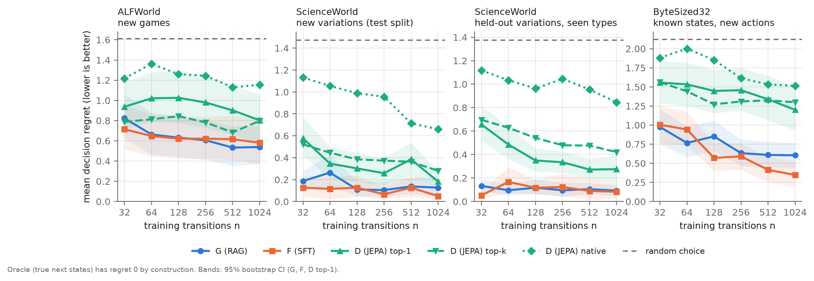
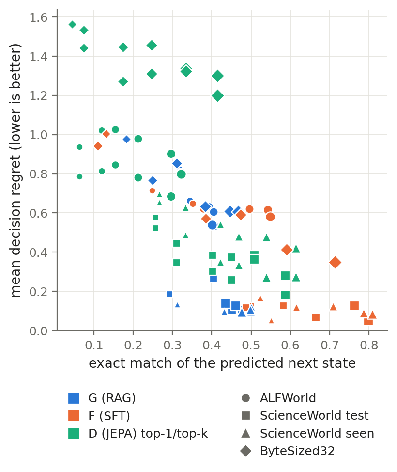
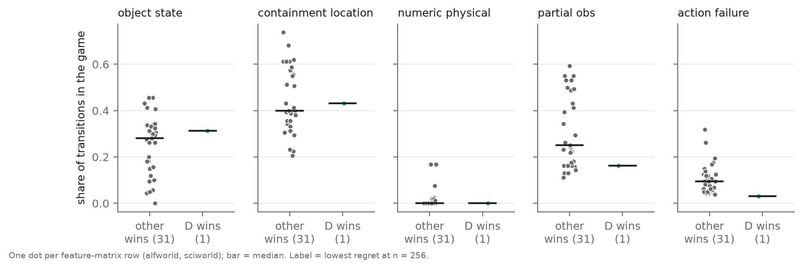
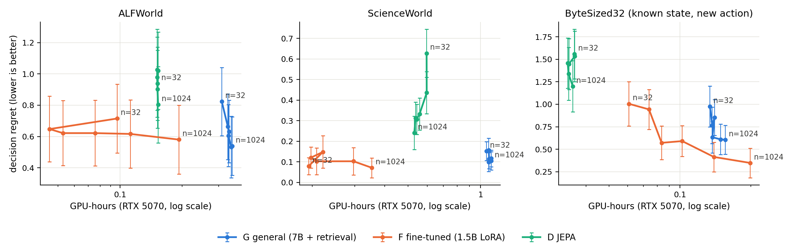
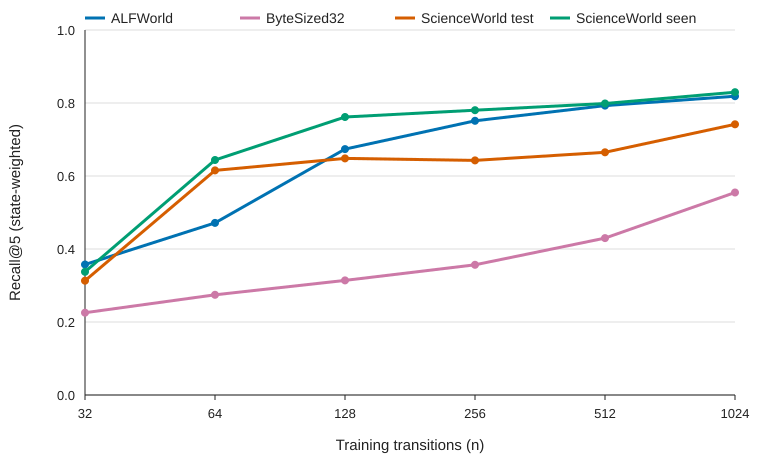

# Is the Specialist Worth It? Decision-Utility and Compute Trade-offs for Text World Models

## Abstract

Teams building text world models must choose, before investing in training, between a frozen general language model with retrieval and a specialist trained on target-environment transitions.  We compare a retrieval-augmented frozen Qwen model (G), a LoRA fine-tuned Qwen model (F), and a JEPA-style latent specialist (D) across four text-environment regimes, six data budgets, shared branched states, and decision regret rather than text fidelity alone.  G and F are statistically tied in 19 of 24 environment-budget cells and both beat D everywhere, while the proposed ex-ante features do not predict a G-versus-F winner but a short JEPA probe ranks the size of D's deficit (out-of-fold rho = 0.29-0.47 across D modes).  Thus, in these regimes, a lightweight fine-tuned generalist is at least as useful and usually cheaper than RAG at scale, whereas a frozen-encoder JEPA specialist is not worth its accuracy cost; the useful pre-training question is how far the specialist will fall behind rather than whether it will win.

## 1 Introduction

A world model predicts how an environment will change after a candidate action, allowing an agent to compare imagined outcomes before acting.  In text environments, a team can either prompt a frozen general LLM with retrieved transitions or train a specialist on collected transitions.  Existing evidence does not make that choice easy in advance: text simulators can be unreliable (Wang et al., 2024), and fidelity objectives need not align with downstream control (Lambert et al., 2020).

We study four regimes: ALFWorld new games, ScienceWorld new variations, held-out ScienceWorld variations from seen task types, and ByteSized32 games with new actions.  From the same nested buffers of n in {32, 64, 128, 256, 512, 1024} transitions, we compare **G**, frozen Qwen2.5-7B-Instruct-AWQ with five hierarchically retrieved demonstrations; **F**, Qwen2.5-1.5B-Instruct with LoRA; and **D**, a JEPA-style predictor over frozen NV-Embed-v2 representations with nearest-state decoding.  At every branched state, each arm predicts outcomes for five candidate actions, a fixed Qwen judge scores those outcomes for goal progress, and the arm chooses the highest-scored action; decision regret is the gap between that action's true score and the best true score.

Our research questions are: **RQ1**, how does decision quality vary by budget and required capability; **RQ2**, when does specialist compute pay off; **RQ3**, can features computed from only 32 transitions predict the winning arm before specialist training; and **RQ4**, can per-decision routing improve on one arm for all decisions?  Across the 24 environment-budget cells, G and F are tied in 19 and F is significantly better in the remaining five; G is never significantly better.  Both generalists beat D at every budget and in every regime, and D never crosses over.  We make four contributions: a decision-utility and compute-priced comparison of G, F, and D; a capability-level analysis; an ex-ante predictor evaluation with leakage-free n = 32 features; and reproducible splits, branched states, scored outcomes, compute logs, and feature matrices.

## 2 Related Work

Wang et al. (2024) introduced ByteSized32-State-Prediction to test whether language models can simulate text-game state transitions, and found that even a strong general model remained unreliable without further innovations.  Li et al. (2026) likewise study whether language models can serve as implicit text-based world models.  These benchmarks motivate our ByteSized32 regime and the separation of visible textual consequences from hidden or unobserved state changes.  We extend this line from next-state accuracy to action selection: a prediction matters here only insofar as it lets an agent rank candidate actions.

Lambert et al. (2020) identify objective mismatch in model-based reinforcement learning: a model can improve one-step prediction likelihood without improving control, and global accuracy is not necessarily the accuracy needed for a local decision.  We adopt this distinction directly by evaluating all arms on matched branched states with decision regret, alongside exact-match fidelity.  The resulting G-versus-F comparison illustrates the point: F has 9-21 percentage points higher exact match at n = 256, yet the two arms have no significant decision-regret difference.

Ashok et al. (2026) compare fine-tuning and RAG for language-model world modeling, finding that fine-tuning often wins while retrieval is relatively data efficient; they also show that hierarchical retrieval can improve on a naive pipeline.  Our G arm follows that retrieval lesson with top-min(50, n/2) observation retrieval, action-similarity reranking, and five demonstrations, while our F arm uses the same training rows as D and G.  We therefore ask the complementary practical question: **before paying to train a specialist, can inexpensive signals predict whether it will be worth it?**

## 3 Method

### 3.1 Data, regimes, and budgets

The study uses ALFWorld new games (193 branched states; six task families), ScienceWorld new variations (182 states; 12 task types), ScienceWorld held-out seen variations (323 states; 20 task types), and ByteSized32 (328 states from 31 games, including 210 gold-unseen states).  All arms use the same budget-specific training rows and nested budgets.  WebShop was planned but dropped for time and is not represented in the results.

### 3.2 World-model arms

G is a frozen Qwen2.5-7B-Instruct-AWQ generator.  It retrieves top-min(50, n/2) buffer transitions by NV-Embed-v2 observation cosine similarity, reranks those candidates by action similarity, and adds the best five transitions to the prompt.  F is Qwen2.5-1.5B-Instruct with rank-16 LoRA, trained to predict next-observation text from observation and action using answer-token loss; it runs for five epochs with a 20-step floor at small budgets.  D encodes observations and actions with frozen NV-Embed-v2, predicts the next-observation embedding with a two-layer JEPA-style predictor, and decodes to the nearest buffer observation; we report top-1, top-k, and native embedding-ranking modes where appropriate.

### 3.3 Decision utility, fidelity, cost, and features

Each branched state has the expert action plus four verb-stratified distractors, excluding observe-only actions.  For G, F, and D's decoded modes, the same frozen Qwen2.5-7B-Instruct-AWQ judge scores true and predicted next outcomes from 0 to 10 for progress to the goal; regret is best true score minus the true score of the selected action, so lower is better.  D native instead ranks candidates in its embedding space, without the judge.  We use paired bootstrap tests over shared states, report exact-match fidelity separately, and log GPU-hours on an RTX 5070.  For RQ3, four feature groups are computed from n = 32 only: a short JEPA probe, capability mix, model-free retrieval Recall@5, and simple environment statistics; Ridge and gradient-boosted predictors are evaluated with leave-one-group-out and leave-one-environment-out validation and 200 permutation shuffles.

## 4 Results

### 4.1 Fidelity and decision utility

F has the highest held-out exact match at n = 256 in all four regimes (56.2%, 69.0%, 71.3%, and 55.6% for ALFWorld, ScienceWorld test, ScienceWorld seen, and ByteSized32 respectively).  That fidelity advantage does not translate into a clear G-versus-F decision advantage: at n = 256, G/F mean regret is 0.61/0.62 in ALFWorld, 0.10/0.07 in ScienceWorld test, 0.10/0.12 in ScienceWorld seen, and 0.63/0.59 in gold-unseen ByteSized32; no G-versus-F difference at n = 256 is significant.

| Regime, n = 256 | Random | G | F | D top-1 |
|---|---|---|---|---|
| ALFWorld, new games | 1.61 [1.39, 1.83] | **0.61 [0.41, 0.81]** | 0.62 [0.42, 0.84] | 0.98 [0.73, 1.24] |
| ScienceWorld test | 1.47 [1.26, 1.70] | 0.10 [0.04, 0.18] | **0.07 [0.02, 0.13]** | 0.26 [0.15, 0.40] |
| ScienceWorld seen | 1.38 [1.23, 1.53] | **0.10 [0.04, 0.16]** | 0.12 [0.04, 0.24] | 0.33 [0.24, 0.43] |
| ByteSized32, gold unseen | 2.12 [1.89, 2.36] | 0.63 [0.47, 0.81] | **0.59 [0.42, 0.76]** | 1.46 [1.19, 1.75] |

Table 1. Mean decision regret at n = 256 (95% bootstrap interval; lower is better).  Values use the 0-10 judge scale; D top-k and native results remain in the finalized detailed source.

Figure 1. Mean decision regret by training budget.  G and F are statistically indistinguishable in 19 of 24 regime-budget cells; F is significantly better in the other five, and G is never significantly better.  Both generalists have lower regret than D at every budget in every regime.

### 4.2 RQ1: capability-level gaps

D's deficit is broad rather than tied to one kind of change.  On pooled ALFWorld and ScienceWorld states at n = 256, F significantly improves on D for containment/location (0.31 versus 0.55 regret), partially observable states (0.36 versus 0.54), and no-visible-change states (0.27 versus 0.83).  G and F are not significantly different by capability on the pooled main regimes; partially observable and containment states remain hardest for all arms.  Numeric/physical and action-failure groups are small, so their estimates are reported but not interpreted as definitive.

### 4.3 Fidelity is not sufficient for utility

Across the 96 text-producing arm/regime/budget points, exact match and regret are associated (pooled Spearman rho = -0.79).  Between the two generalists, however, F's 9-21 point fidelity lead at n = 256 does not yield a significant regret lead: the best-fidelity arm is the best-utility arm in only 22 of 30 comparable cases.  This is a modest empirical instance of the objective mismatch described by Lambert et al. (2020).

Figure 2. Exact-match fidelity versus decision regret.  Fidelity separates the generalists from D more reliably than it separates G from F.

### 4.4 RQ3: ex-ante prediction

The features do not predict a G-versus-F winner: the best balanced accuracy is 0.52 (p = 0.34), and no learned three-arm winner predictor exceeds the constant-F baseline (0.69 versus 0.72 accuracy).  This negative result follows from the outcome distribution: G and F are mostly tied and both beat D.  The narrower positive result is that the JEPA probe alone ranks the size of D's deficit to F in all three D modes (out-of-fold rho = +0.47, +0.34, and +0.29; p = 0.010, 0.045, and 0.040), whereas the more expensive SFT probe does not.  Appendix A reports the descriptive, state-weighted Recall@5 retrieval coverage behind G; it is not an RQ3 feature measurement.

Figure 3. Capability mix and specialist outcomes.  With final three-arm labels, no feature-matrix row is a D win, so no capability profile identifies a regime where the specialist wins.

### 4.5 RQ4: routing and RQ2: compute

At n = 256 on the 698 pooled main-regime states, the best single arm (G) has mean regret 0.239; a leave-one-state-out capability router reaches 0.213, a non-significant gain of +0.026 (95% CI -0.030 to +0.082).  An oracle per-state router reaches 0.102, an optimistic upper bound because it chooses every favorable realization.  Thus, capability is not an adequate routing signal, although per-state uncertainty may be useful future information.

Across all six budgets, G costs 0.96, 3.03, and 0.69 GPU-hours for ALFWorld, ScienceWorld, and ByteSized32, compared with F's 0.60, 1.52, and 0.70; D is cheaper (0.36, 1.10, and 0.39) but worse everywhere.  At n = 256 before evaluation, F costs 0.08/0.21/0.10 GPU-hours versus G's 0.33/1.08/0.14 for ALFWorld/ScienceWorld/ByteSized32.  G avoids training but pays for long-prompt 7B generation; when many predictions are needed, F is the cheaper of the two equally useful generalists.

Figure 4. Decision regret against arm construction and execution cost.  D never reaches G's best regret at any measured cost.

## 5 Discussion

The practical answer in these data is not to train the frozen-encoder JEPA specialist: it is consistently worse in decision regret, and its compute saving is small in absolute terms.  The two generalists have the more nuanced relationship: F wins fidelity but is usually tied with G in utility, so a utility-aware evaluation prevents overclaiming from text overlap.  D's failure is consistent with three constraints: nearest-neighbor decoding is bounded by buffer coverage, deterministic feedback text favors direct text fine-tuning, and frozen sentence embeddings drop object identifiers and quantities.  The InfoNCE and learned-decoder ablations do not repair this: even a decoder fed the true next-state vector remains below F, locating the larger limitation in the frozen embedding rather than the JEPA loss.

Our RQ3 result is deliberately negative.  A learned predictor cannot meaningfully predict a winner when the answer is nearly constant--G and F tie, and both beat D--but the short JEPA probe offers a cautious diagnostic of how large D's failure will be.  The routing result similarly distinguishes theoretical headroom from a deployable policy: an oracle can improve regret, but capability labels do not explain the disagreements.

## 6 Limitations

- **Small and one-sided RQ3 sample.** The main predictor uses 26 independent labels from ALFWorld and ScienceWorld; ByteSized32 is separate.  With G added, no feature-matrix row is a D win, while G-versus-F is mostly tied, so the specialist-win question cannot be learned.  Treat the predictor as a proof of concept, not a tool.
- **One budget and one seed for labels.** Labels use n = 256 and one training run per arm, with F trained on D's rows.  Bootstrap intervals reflect state sampling rather than seed variance; only 8 of 27 F-versus-D, 6 of 27 G-versus-D, and 1 of 27 G-versus-F group differences have a 95% interval excluding zero.
- **Multiple small-sample analyses.** Feature sets, two probes, three D modes, and two cross-validation schemes are evaluated on few labels without multiplicity correction.  The JEPA-probe result (p = 0.010-0.045) is therefore suggestive.
- **One frozen judge defines utility.** The Qwen2.5-7B-Instruct-AWQ judge is a 4-bit deviation from the planned full-precision model.  Its recorded-reward agreement is 74-85%, but utility remains one-step lookahead over five candidates; the pre-registered data sanity check failed one of three acceptance rules.
- **G shares the judge's base model.** A stylistic self-preference could favor G's generated text.  A second judge model is needed to test that possibility.
- **Architecture confounds remain.** G is a 7B model and F a 1.5B model, so construction method is confounded with model size.  D's decoded modes also conflate its embedding predictor with nearest-neighbour decoding, while native mode replaces the judge with D's own goal similarity.
- **Regimes and data deviate from the original plan.** ALFWorld has new games, ScienceWorld has new or held-out variations, and ByteSized32 has new actions in training states; 118 of its 328 states contain a gold transition already in training.  WebShop was dropped for time, planned LLM-driven buffer rows were not collected, and branched states exclude observe-only distractors.
- **Routing is an offline upper bound.** RQ4 does not train or deploy a router, and the per-state oracle benefits from one-seed and judge noise; multi-step rollouts could change the subsequent state distribution.
- **Two G comparison artifacts are unavailable.** The planned G-versus-action-lookup comparison was not run because no scored action-lookup output is available with a shared utility field.  Raw G prompts and `pred_next` JSONLs were not retained in this checkout; scored G decision outputs remain, but they cannot reproduce the generated text or support a post-hoc raw-prediction audit.

## 7 Conclusion

We contribute a matched, compute-priced three-arm comparison, a capability-level decision analysis, and an ex-ante feature evaluation; the two most informative negative findings are that the frozen-encoder JEPA specialist never beats either generalist and that fidelity's 9-21 point F-over-G advantage does not produce a reliable utility advantage, while future work should test multiple seeds and judges, size-matched G/F controls, trainable task-specific encoders, a restored partially observable WebShop regime, and uncertainty-aware routing.

## Appendix A. G retrieval coverage

Figure A1. Recall@5 of G's hierarchical retriever on the branched evaluation states, by training-transition budget.  Each point is the mean across per-game or per-task groups weighted by that group's number of branched states, rather than an unweighted mean of groups.  It is descriptive retrieval coverage evaluated with the gold action and is distinct from the leave-one-out, training-only Recall@5 feature used for RQ3.

## References

- Ashok, D., Agarwal, S., Datla, V., May, J., & Samuel, A. (2026). *How To Train Your World Model: Fine-tuning vs RAG for LM-based World Modeling*. arXiv:2610.02542. https://arxiv.org/abs/2610.02542
- Lambert, N., Amos, B., Yadan, O., & Calandra, R. (2020). *Objective Mismatch in Model-based Reinforcement Learning*. Proceedings of Machine Learning Research, 120, 761-770. https://proceedings.mlr.press/v120/lambert20a.html
- Li, Y., Wang, H., Qiu, J., Yin, Z., Zhang, D., Qian, C., et al. (2026). *From Word to World: Can Large Language Models be Implicit Text-based World Models?* Proceedings of ACL 2026, 8084-8111. https://aclanthology.org/2026.acl-long.366/
- Wang, R., Todd, G., Xiao, Z., Yuan, X., Cote, M.-A., Clark, P., & Jansen, P. (2024). *Can Language Models Serve as Text-Based World Simulators?* Proceedings of ACL 2024, 1-17. https://doi.org/10.18653/v1/2024.acl-short.1

## Source-of-truth map

- Introduction: `docs/paper/introduction.md`
- Finalized results, discussion, limitations, full confidence intervals, and detailed tables: `docs/paper/results_discussion.md`
- RQ3 predictor: `results/rq3/README.md`
- RQ1/RQ4 provenance: `docs/paper/rq1_capability_rq4_router.md`
- Tables and figures: `results/figures/`, `results/crossover/`, `results/capability_regret/`, and `results/compute/cost_table.csv`
